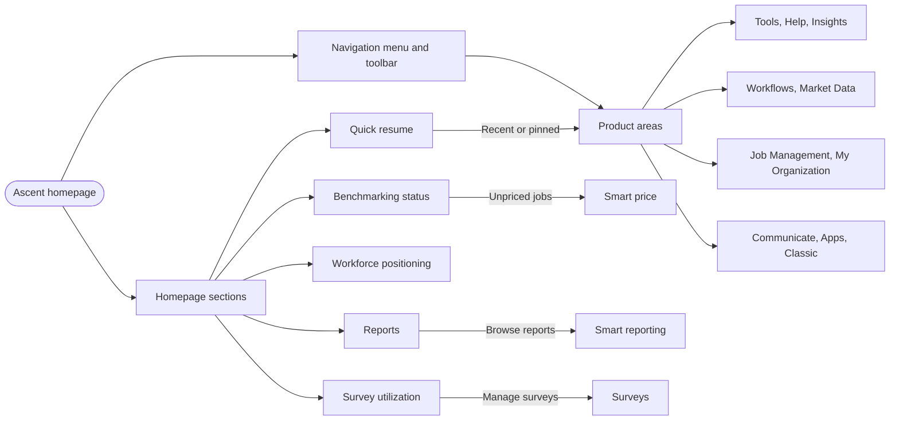

<a href="/ascent-premier-core">Ascent Premier and Core</a>›<a href="/ascent-premier-core/explanation">Explanations</a>

import { VideoWidget } from "/snippets/video-widget.jsx";

<VideoWidget src="https://player.vimeo.com/video/1208149688?h=3004dce78c" title="Understanding the Ascent Homepage" />

Compensation work spans many tools: uploading data, pricing jobs, checking how your pay compares to the market, and reporting. Without a single starting point, it's hard to know what needs attention first. The Ascent homepage is that starting point. It gives you quick access to your workflows and shows insights you can act on.

<Note>
You may not see every product area or homepage section. What you see depends on your subscription.
</Note>

## How the Homepage Is Organized

The homepage has two parts that work together.

- **The navigation menu and toolbar** get you to any product area. Product areas are grouped by purpose: Tools, Help, Insights, Workflows, Market Data, Job Management, My Organization, Communicate, Apps, and Classic.
- **Homepage sections** show the state of your data at a glance and link to the page where you can act on it. For example, if the **Benchmarking status** section shows unpriced jobs, you can go straight to **Smart price** to price them.

## Making It Yours

You choose which sections appear and in what order, so the homepage reflects the work you do most. **Quick resume** always stays on the page because it's the fastest way back to where you left off. It shows your six most recently visited product areas, or six you've pinned.

Some settings are shared. The target percentile in **Workforce positioning**, for example, applies to everyone in your organization, so everyone compares pay to the same target.

## Tutorials

- [Quick Start: Customize Your First Homepage](/ascent-premier-core/quick-start/customize-your-first-homepage)

## How-To Guides

- [Customizing the Homepage](/ascent-premier-core/how-to/customizing-the-homepage)
- [Navigating the Toolbar](/ascent-premier-core/how-to/navigating-the-toolbar)
- [Using the Benchmarking Status Section](/ascent-premier-core/how-to/using-the-benchmarking-status-section)
- [Setting Your Workforce Positioning Target](/ascent-premier-core/how-to/setting-your-workforce-positioning-target)

## References

- [Homepage Product Areas](/ascent-premier-core/reference/homepage-product-areas)
- [Homepage Sections](/ascent-premier-core/reference/homepage-sections)
