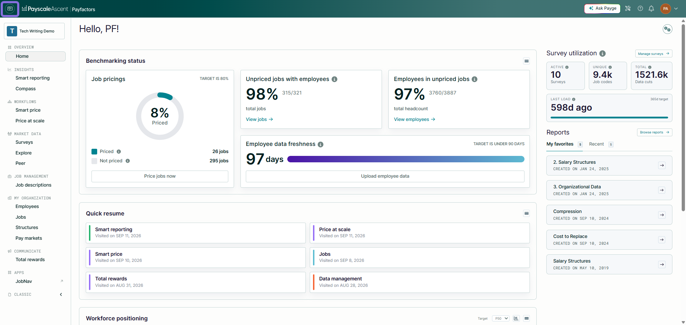
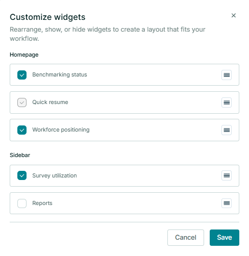
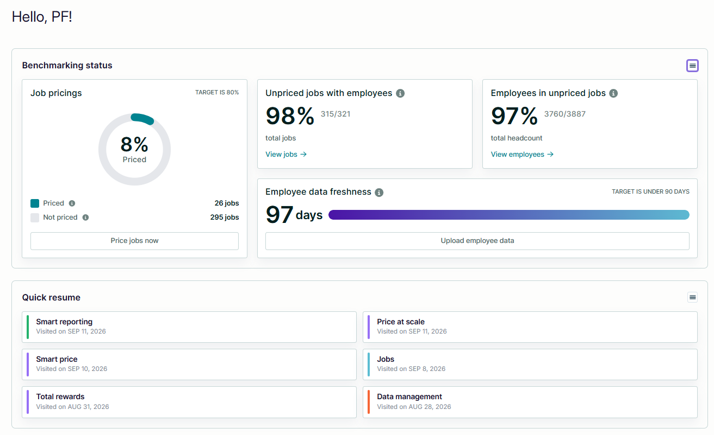

<a href="/ascent-premier-core">Ascent Premier and Core</a>›<a href="/ascent-premier-core/how-to">How-To Guides</a>

Customize your homepage to show the sections you use most and hide the rest. Your homepage options may vary based on your subscription.

To customize your homepage:

1. In the upper left corner of the page, expand or collapse the navigation menu, as needed.

   

   <Note>
   You can expand or collapse the navigation menu from any product area.
   </Note>

2. If your menu is collapsed, hover over the relevant icon and click the feature you want.
3. To show, hide, or reorder sections from a list:
   1. Click the **Customize widgets** icon.
   2. From the **Customize widgets** window:
      1. To show or hide a section, check or uncheck its box.

         <Note>
         **Quick resume** can't be hidden.
         </Note>

      2. To reorder the sections, drag the **Drag Handle** icon next to a section to a new position.
      3. Click **Save**.

   

4. To reorder sections directly on the homepage, drag and drop the relevant section.

   

## See Also

- [Homepage Sections](/ascent-premier-core/reference/homepage-sections): What each section shows and where it takes you.
- [Understanding the Ascent Homepage](/ascent-premier-core/explanation/understanding-the-ascent-homepage): Why the homepage is organized the way it is.
