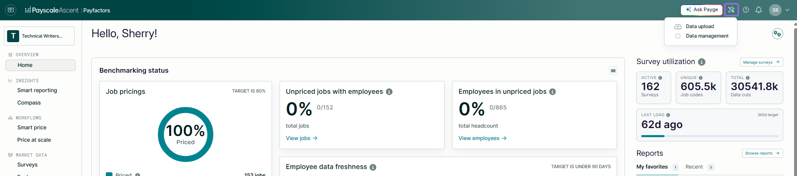
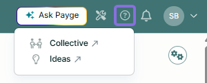
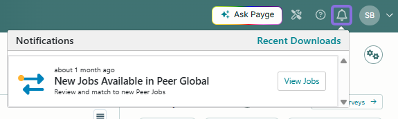
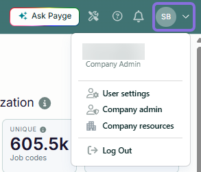

<a href="/ascent-premier-core">Ascent Premier and Core</a>›<a href="/ascent-premier-core/how-to">How-To Guides</a>

The toolbar is at the top of your homepage.

To navigate the toolbar:

1. To access **Data upload** and **Data management**, click the **Tools** icon.

   

2. To submit a ticket, access Payscale Collective, or submit an idea for the platform, click the **Help** icon.

   

3. To view your notifications, click the **Notifications** icon.

   

4. To access your user settings, Company Admin features, and company-wide resources, or to log out, expand your **Profile** and click the relevant option.

   

## See Also

- [Homepage Product Areas](/ascent-premier-core/reference/homepage-product-areas): Every product area and what it offers.
- [Administration & Configuration](https://collective.payscale.com/administration-configuration-ascent-payfactors-138): Details on the features in your profile menu.
