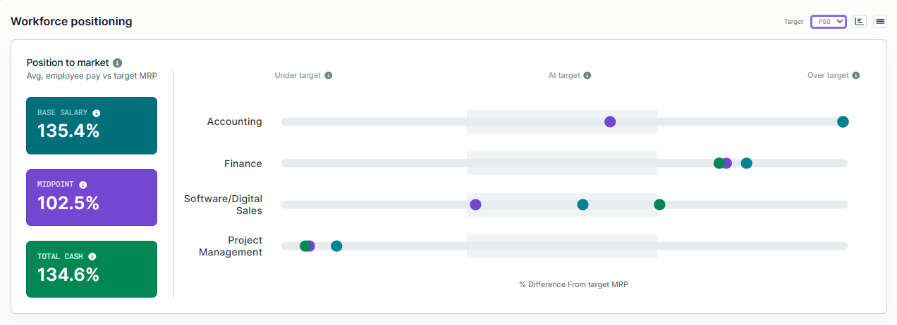
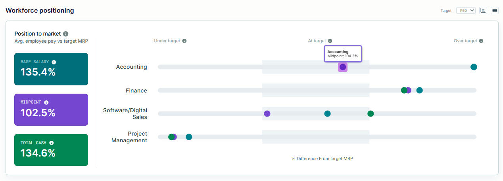

<a href="/ascent-premier-core">Ascent Premier and Core</a>›<a href="/ascent-premier-core/how-to">How-To Guides</a>

The **Workforce positioning** section compares your pay to a target percentile. The default is the 50th percentile. Changing the target recalculates every card and chart in the section.

<Note>
The target you select applies to all users in your organization and persists across sessions.
</Note>

To set your target percentile:

1. In the **Workforce positioning** section, expand the **Target** dropdown and select a percentile: P10, P25, P50, P60, P75, or P90.

   

2. To see more detail about a data point, hover over its marker on the chart.

   

3. To open **Smart reporting**, click the icon next to the chart. This icon appears only if you have access to **Smart reporting**.

   

import { PracticeWidget } from "/snippets/practice-widget.jsx";
import { WorkforcePositioning } from "/snippets/workforce-positioning.jsx";

<PracticeWidget title="Workforce positioning" blurb="Change the target percentile and watch every row recalculate.">
  <WorkforcePositioning />
</PracticeWidget>

## See Also

- [Homepage Sections](/ascent-premier-core/reference/homepage-sections): How the Workforce positioning chart is built.
