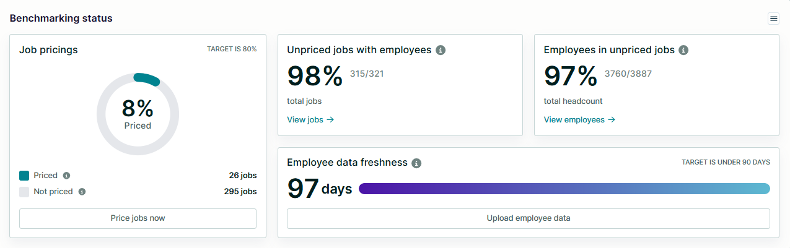
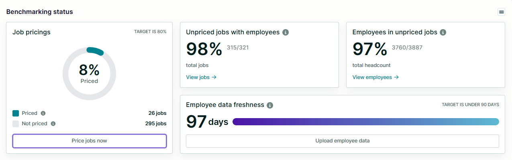
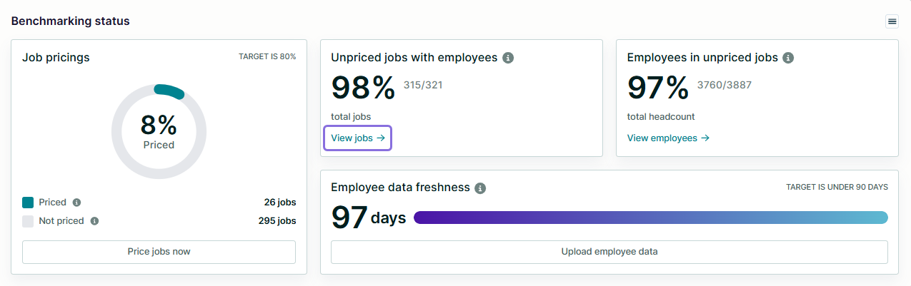
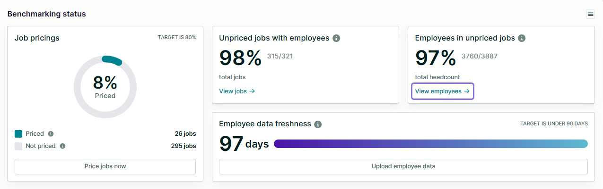
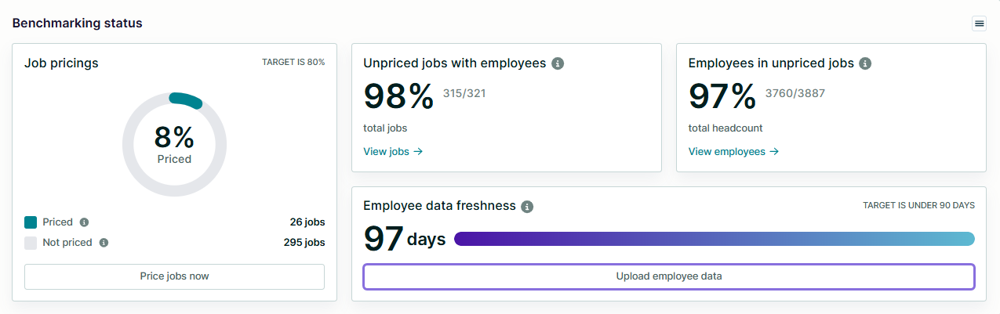

<a href="/ascent-premier-core">Ascent Premier and Core</a>›<a href="/ascent-premier-core/how-to">How-To Guides</a>

The **Benchmarking status** section shows how much of your workforce is priced and how fresh your employee data is. Use its buttons to go straight to the page where you can act.

To use the **Benchmarking status** section:

1. To price jobs, click **Price jobs now**. You're taken to the **Smart price** page.

   

2. To view your jobs, click **View jobs**. You're taken to the **Jobs** page, filtered to the unpriced jobs in your chosen pay market.

   

3. To view your employees, click **View employees**. You're taken to the **Employees** page, filtered to the employees in unpriced jobs in your chosen pay market.

   

4. To upload your employee data, click **Upload employee data**. You're taken to the **Data upload** page.

   

## See Also

- [Homepage Sections](/ascent-premier-core/reference/homepage-sections): What each card in this section measures.
