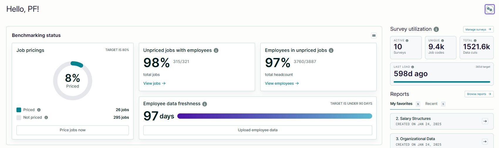
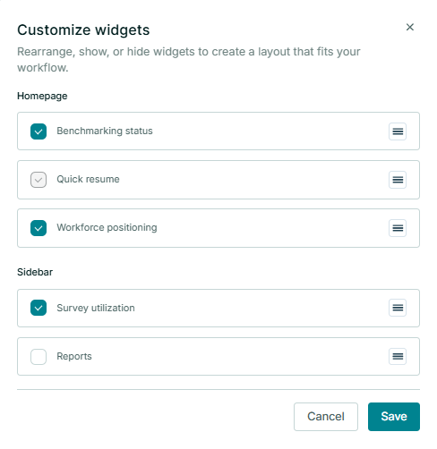
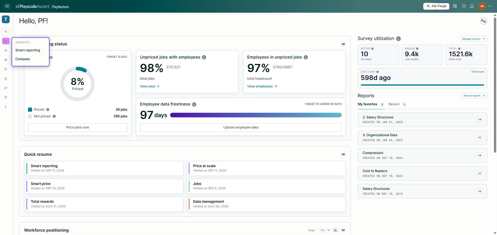

<a href="/ascent-premier-core">Ascent Premier and Core</a>›<a href="/ascent-premier-core/quick-start">Quick Start</a>

In this quick start, you'll customize your Ascent homepage by hiding and reordering a section, so you can see how the homepage fits together. You'll put everything back at the end, so nothing is lost.

To customize your homepage:

1. Log in to Ascent. You land on your homepage.
2. Click the **Customize widgets** icon. The **Customize widgets** window opens.

   

3. Uncheck the box next to any section except **Quick resume**, which can't be hidden.

   

4. Drag a section's **Drag Handle** icon up or down to move it to a new position in the list.
5. Click **Save**. Your homepage now shows your changes.
6. In the upper left corner of the page, collapse the navigation menu. Hover over an icon to see where it leads, then expand the menu again.

   

7. To clean up, click the **Customize widgets** icon again, check the box for the section you hid, drag the sections back into their original order, and click **Save**.

import { PracticeWidget } from "/snippets/practice-widget.jsx";
import { HomepageSandbox } from "/snippets/homepage-sandbox.jsx";

<PracticeWidget title="Customize widgets" blurb="Practice showing, hiding, and reordering homepage sections.">
  <HomepageSandbox />
</PracticeWidget>

To customize your homepage for real, see Customizing the Homepage. For an explanation of the homepage, see Understanding the Ascent Homepage.
