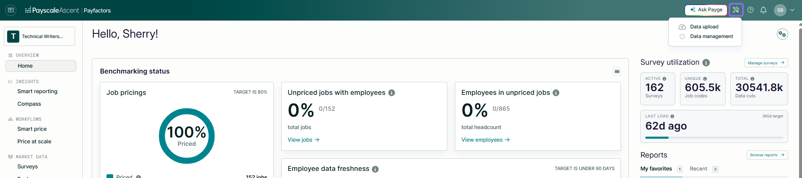
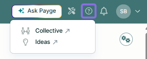
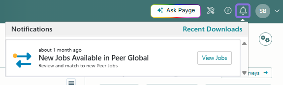
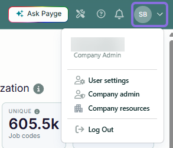

<a href="/payfactors">Payfactors</a>›<a href="/payfactors/how-to">How-To Guides</a>

The Ascent toolbar is located at the top of your homepage.

To navigate the toolbar:

1. Access **Data upload** and **Data management** by clicking the **Tools** icon, .

   

2. To submit a ticket, access **Payscale Collective**, or submit an idea for the platform, click the **Help** icon, .

   

3. To view your notifications, click the **Notifications** icon, . For more information, see Viewing and Managing In-App Notifications.

   

4. Access your user settings, Company Admin features, and company-wide resources or log out by expanding your *Profile* and clicking the relevant option. For more information on the available features, see [Administration & Configuration](https://collective.payscale.com/administration-configuration-ascent-payfactors-138).

   
