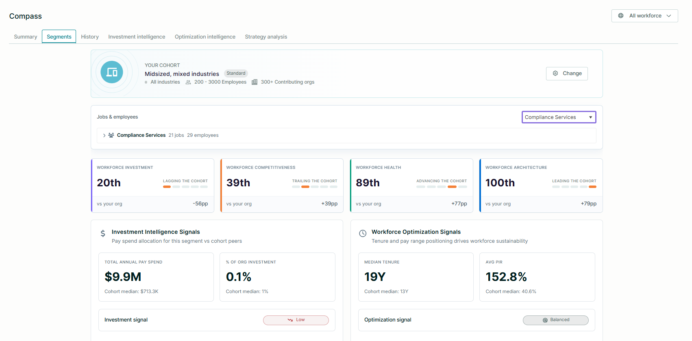
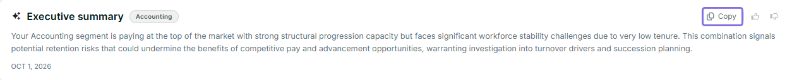
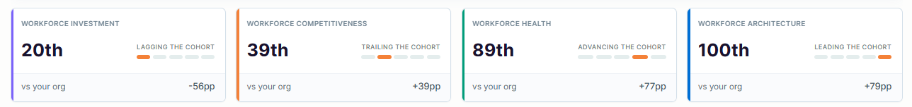
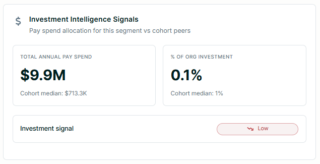
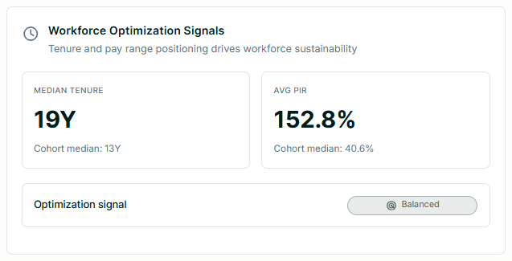

<a href="/payfactors">Payfactors</a>›<a href="/payfactors/how-to">How-To Guides</a>

The **Compass Segment performance** page displays a segment's current **Compass** position and the drivers behind it, giving leaders a way to understand what's happening in a segment when questions arise at the executive leadership team or board level. This view connects position and intelligence in one place for focused, in-context analysis.

## Accessing the Segment Performance Page

To access the **Segment performance** page, navigate to the **Compass Segment tab** and click the relevant segment card. For more information, see Compass: Viewing Workforce Segments.

## Managing the Segment Performance Page

To manage the **Segment performance page**:

1. Change your cohort and/or workforce location, as needed. For information on changing your cohort, see Compass: Managing the Summary Page.
2. To include employees from only one workforce location, from the *Workforce Location* dropdown, select the relevant location. For more information, see Compass: Adjusting Your Workforce Location.
3. To change your segment, from the **Jobs & Employees** section, click the dropdown and select the relevant segment. For more information, see Compass: Managing the Summary Page.

   

4. To copy the **Executive summary**, click **Copy**. The summary is an AI-authored executive narrative that interprets your segment's market position across all four dimensions. It's written for non-HR audiences and translates the data into a board-ready story.

   

   <Note>
   To help us improve the feature, you may provide feedback on the summary by clicking the **Helpful** icon, , or **Not Helpful** icon, , as desired.
   </Note>

5. View the **Workforce Investment**, **Competitiveness**, **Health**, and **Architecture** cards, as needed. Each displays the percentile indicating your position within your cohort, a delta showing the difference between the segment position and the whole organization's position, and a text label with corresponding position pills. For more information, see Compass: Managing the Summary Page.

   

6. From the **Investment Intelligence Signals** section, view the **Total Annual Pay Spend**, **% of Org Investment**, and your segment's **Investment signal**. This section displays the allocation of pay dollars across the segment compared to cohort equivalents.

   

7. **Workforce Optimization Signals** section, view the **Median Tenure**, **Avg PIR**, and your segment's **Optimization Signal**.

   
