
<a href="/payfactors">Payfactors</a>›<a href="/payfactors/how-to">How-To Guides</a>

The Ascent homepage offers a number of features, providing streamlined access to workflows and displaying actionable insights. For information about the different product areas, see [Ascent Payfactors Homepage Overview](/payfactors/reference/ascent-payfactors-homepage-overview). For information about the toolbar, see [Ascent Payfactors: Navigating the Toolbar](/payfactors/how-to/ascent-payfactors-navigating-the-toolbar).

Homepage functionality may vary based on your subscription.

<Note>
For more information, see the [Academy: Welcome to Payfactors Course](https://academy.payscale.com/payfactors-learning-path-welcome-to-payfactors).
</Note>

To manage your homepage:

1. In the upper left-hand corner of the page, expand/collapse your Navigation Menu, as needed.

   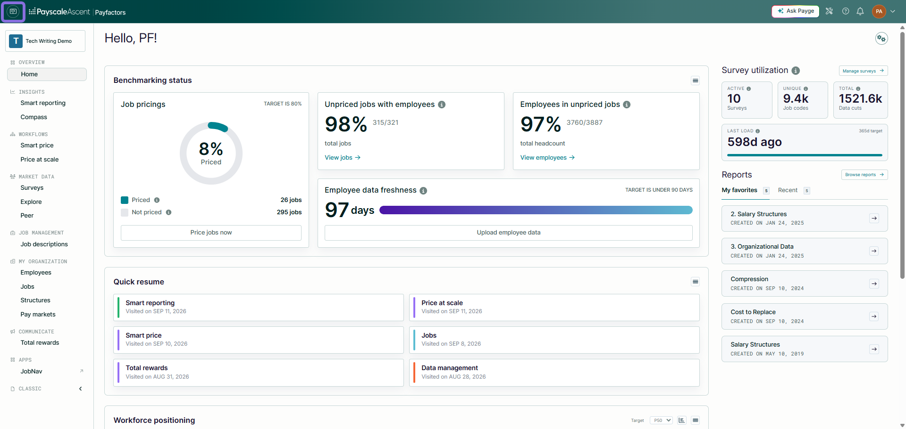

   <Note>
   From any product area, you can expand/collapse your Navigation Menu.
   </Note>

2. If your menu is collapsed, hover over the relevant icon and click your desired feature location.

   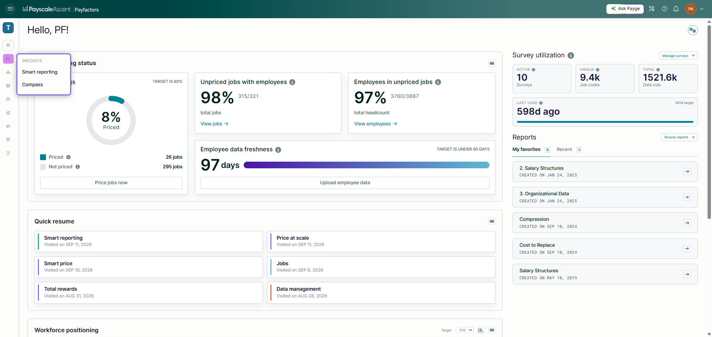

3. To customize your view:
   1. Click the **Customize widgets** icon, .

      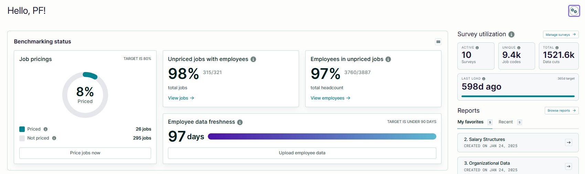

   2. From the **Customize widgets** window:

      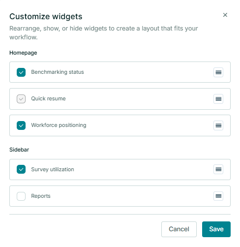

      1. To show/hide the available sections, check or uncheck the associated box.

         <Note>
         **Quick resume** can't be hidden.
         </Note>

      2. To reorder the sections, drag-and-drop the associated **Drag Handle** icon, .
      3. Click **Save**.
4. To reorder your homepage sections, drag-and-drop the relevant sections, as needed.

   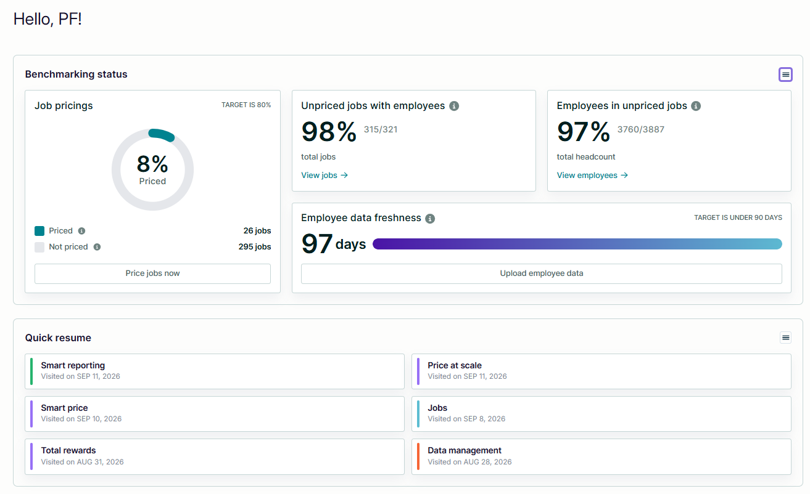

## Benchmarking Status

The **Benchmarking status** section displays four different cards:

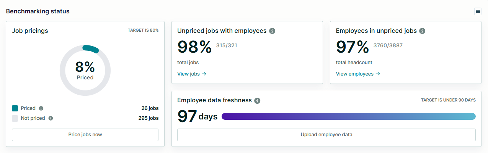

- **Job pricings:** Displays a chart showing percent of active jobs priced and published, including slotted jobs.
- **Unpriced jobs with employees:** Displays the percentage and raw count of your jobs that haven't been priced in a pay market with at least one employee assigned. Unique job codes are counted, not individual employee-pay market combinations.
- **Employees in unpriced jobs:** Displays the percentage and raw count of your employees whose job code hasn't been priced in their assigned pay market.
- **Employee data freshness:** Displays the days since your last employee file upload and a progress bar with 90 days being the bar's limit.

To use the **Benchmarking status** section:

1. Price jobs by clicking **Price jobs now**. You'll be taken to the **Smart price** page.

   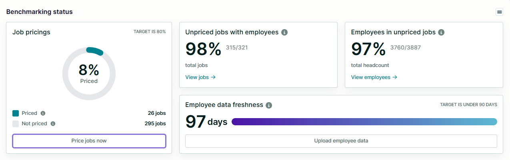

2. To view your jobs, click **View jobs**. You'll be taken to the **Jobs** page, filtered to the unpriced jobs in your chosen pay market.

   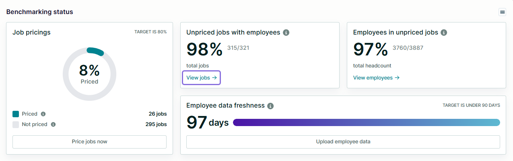

3. To view your employees, click **View employees**. You'll be taken to the **Employees** page, filtered to the employees associated with unpriced jobs in your chosen pay market.

   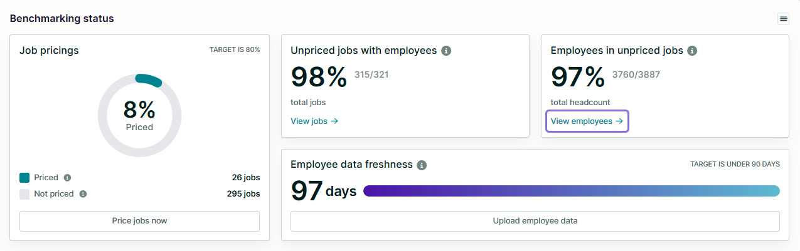

4. To upload your employee data, click **Upload employee data**. You'll be taken to the **Data upload** page.

   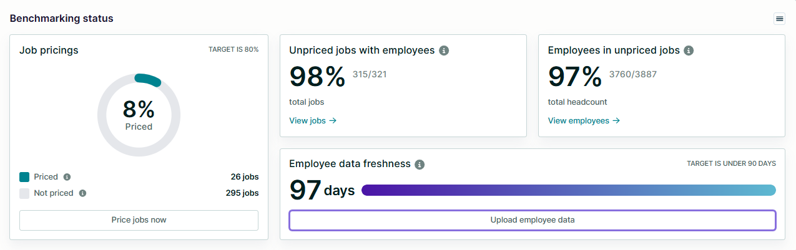

## Quick Resume

The **Quick resume** section displays the six most recently visited product areas by the user or six product areas you'd like to pin. Click the relevant product area to return to that location.

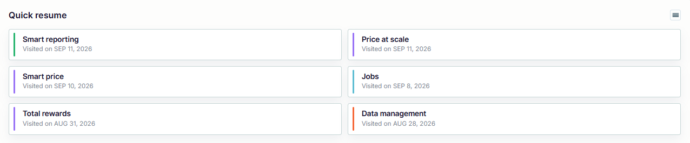

## Workforce Positioning

The **Workforce positioning** section's visualization will display up to four of the largest job families in the user's site by employee count. It renders one row per job family and applies the same ratio of sums calculation scoped to each job family. The data markers are positioned relative to the target MRP, which defaults to 50th percentile and can't be customized at this time. For more information on the **Workforce positioning's** data, see Ascent Payfactors Homepage: Understanding Workforce Positioning.

To use the **Workforce positioning** section:

1. Set the target percentile by expanding the *Target* dropdown and selecting the relevant number (i.e., "P10," "P25," "P50," "P60," "P75," "P90"). The cards and charts will recalculate to account for the selected target percentile. The selection will persist across all sessions for all users in your organization.

   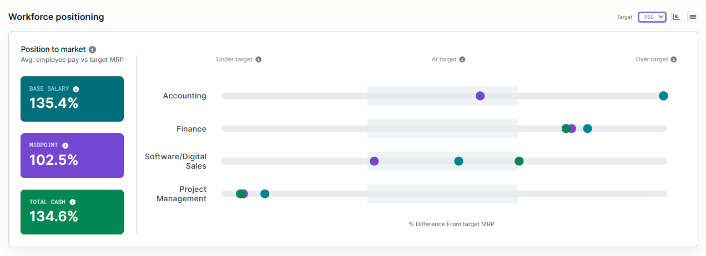

2. To go to **Smart reporting**, click the chart's associated icon, . This icon is only available for those users with access to **Smart reporting**.

   

3. See additional data point information by hovering over the relevant data markers on the chart.

   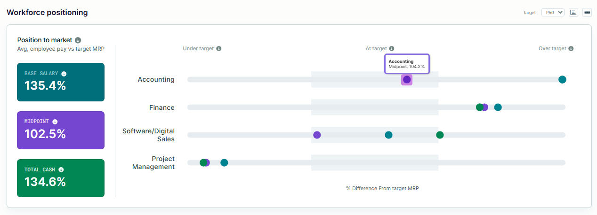

## Survey Utilization

The **Survey utilization** section displays an active survey count, a unique job codes count, a data cuts count, and the last load date targeting 365 days.

To manage your surveys, click **Manage surveys**. You'll be taken to the **Surveys** page.

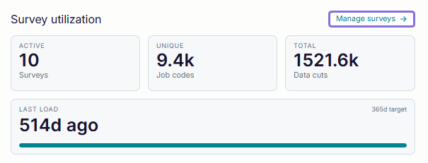

## Reports

The **Reports section** displays two tabs: **My favorites** and **Recent**. Your favorite reports come from the **Favorites** section of **Smart reporting**. Recent reports include the most recently added and created smart reports for your site. Each card shows the report name and date created.

To view your reports:

1. View all reports by clicking **Browse reports**. You'll be taken to the **Smart reporting** page.

   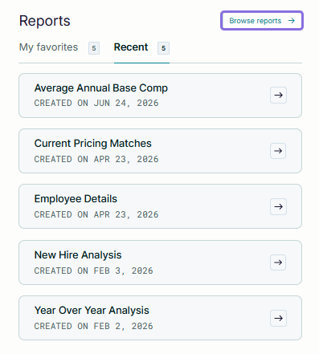

2. To view one of the reports listed, navigate to the **My favorites** or **Recent** tab and click the relevant card.

   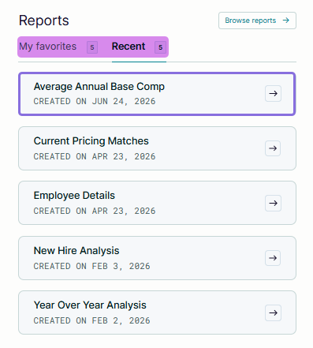
