
<a href="/payfactors">Payfactors</a>›<a href="/payfactors/how-to">How-To Guides</a>

From the **Universal job matches** tab, you can search for your jobs, filter jobs, show/hide columns from the **My jobs** table, import matches, and manage survey publishers to jobs.

To learn about searching, filtering, and showing/hiding columns from the **My jobs** table, see Price at Scale: Managing the My Jobs Table. To learn about importing matches, see Price at Scale: Importing Matches.

## Managing Adding Survey Publishers to Jobs

To manage adding survey publishers to jobs:

1. From the **My jobs** table, click the relevant job.

   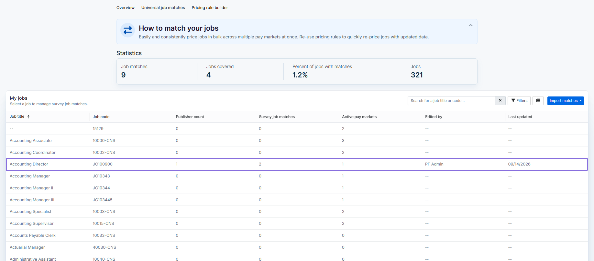

2. Within the **Survey Job Matches** section, you can view a job summary of your selected job, as needed.

   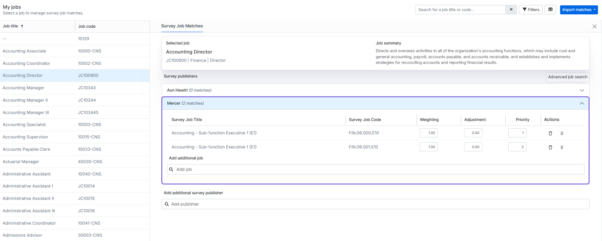

### Adding Survey Job Matches to Survey Publishers

To add survey job matches to your survey publishers:

1. From the **Survey publishers** section, locate the relevant publisher. Expand the specific publisher's area, as needed.

   

   <Note>
   This section displays all publisher matches that already exist. Publishers with potential matches available for your company job will have their section automatically expanded.
   </Note>

2. From the *Add additional job* field, enter the related job title and select the relevant job from the populated list.

   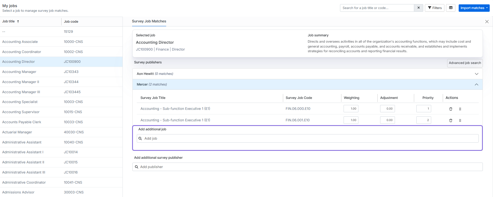

3. To access additional job options:
   1. Click **Advanced job search**.

      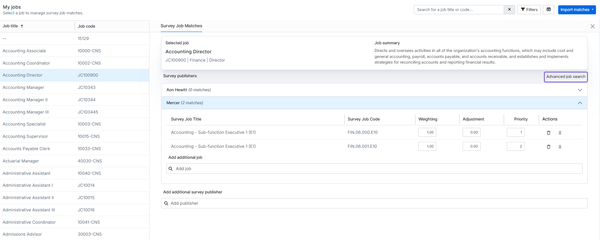

   2. From the **Add Data** window:
      1. Search or filter for jobs, as needed.

         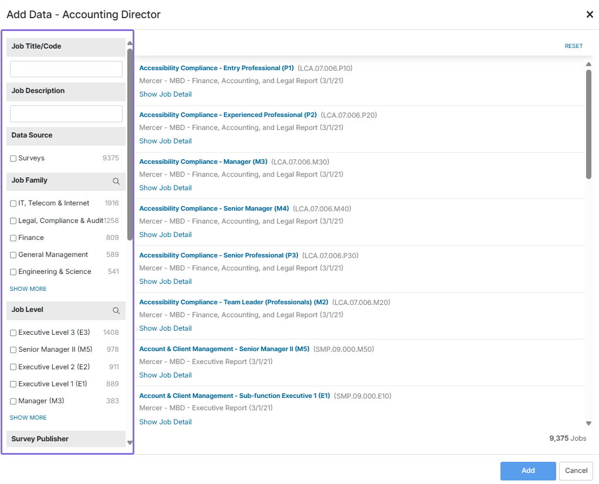

      2. Select the relevant job(s) and click **Add**.

         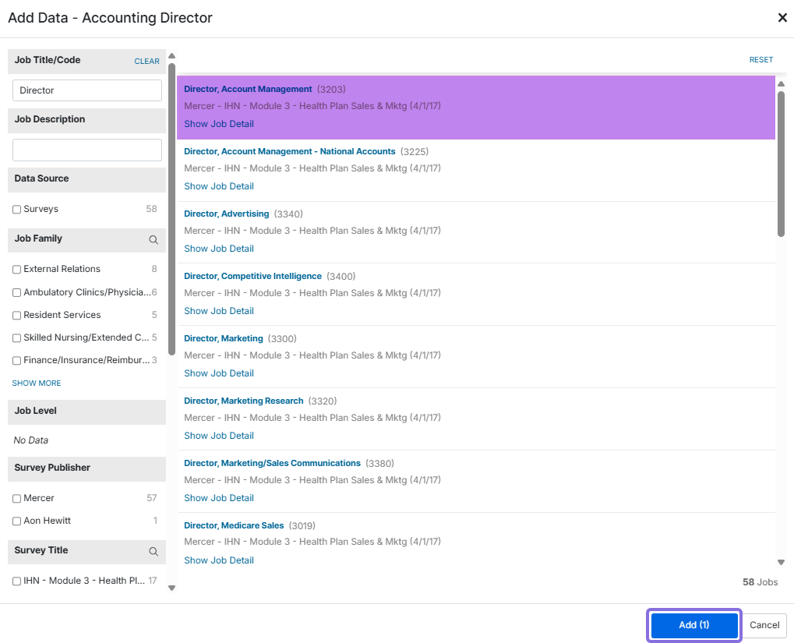

### Managing Survey Publisher Jobs

To manage your survey publisher jobs:

1. From the **Survey publishers** area, locate the relevant publisher. Expand the specific publisher's area, as needed.

   

2. To view a survey job's summary and the survey titles the job appears in, expand the relevant job.

   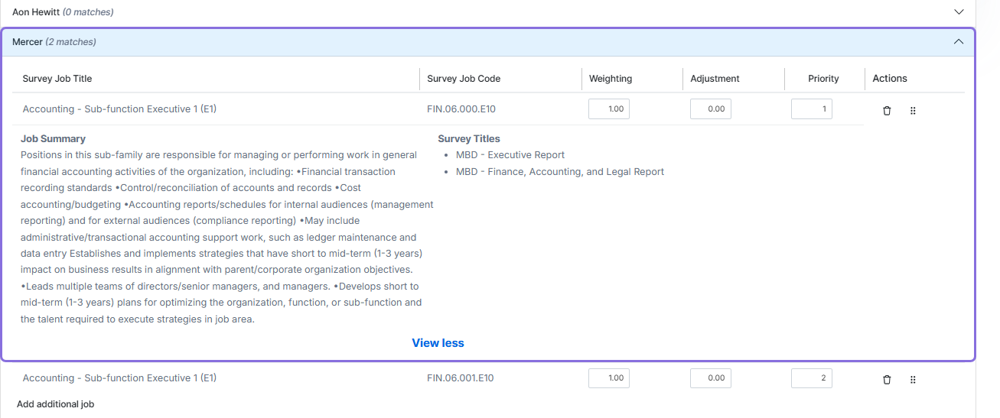

3. Edit the *Weighting* and *Adjustment* columns, as needed. These may also be added when running the pricing rules.

   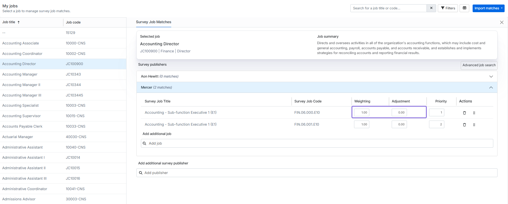

4. To adjust their priority positions, do one of the following:
   1. Drag-and-drop jobs into the relevant order. The *Priority* will automatically adjust.

      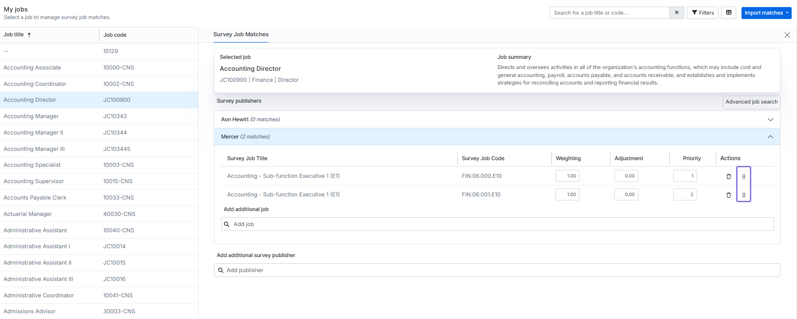

   2. Alternatively, within the *Priority* field, renumber the relevant jobs. The system will automatically correct jobs not numbered sequentially. For example, if a user has three jobs, the *Priority* column should contain '1', '2', '3', respectively. If a user attempts to enter '4' instead of '3', the system will return the entry to '3'.

      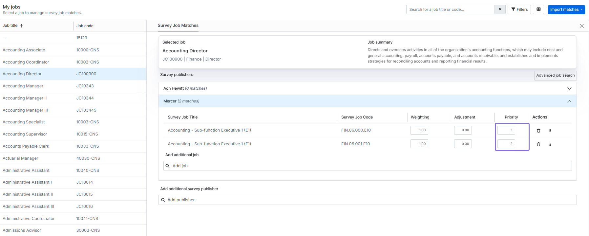

      <Note>
      These priorities are used when pricing rules are processing.
      </Note>

5. To delete a job:
   1. Click the associated **Delete** icon, .

      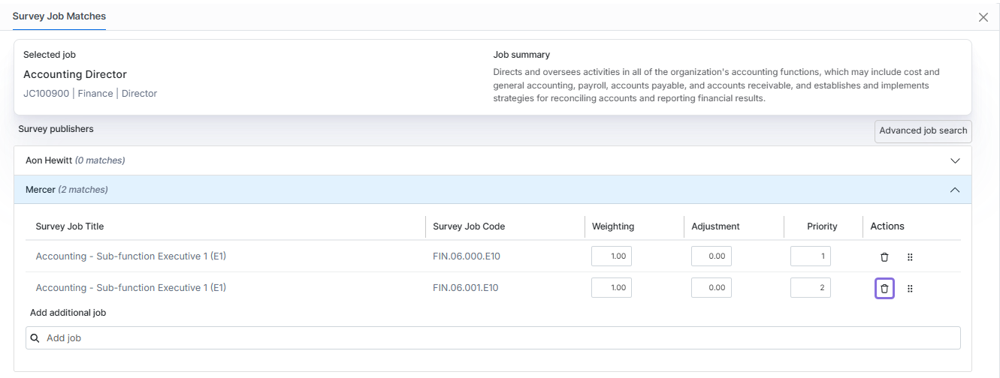

   2. From the **Delete universal job match** window, click **Delete**.

      
