
<a href="/payfactors">Payfactors</a>›<a href="/payfactors/how-to">How-To Guides</a>

At this stage, your selected jobs have been matched to benchmark jobs from your selected data sources, including AI match suggestions. From the **Benchmark** workflow, review and edit your job matches, including adding skills and certifications for relevant Peer Enhanced jobs. You can also set the target percentile, as needed.

For information on the **Benchmark** table, see Smart Price: Understanding the Benchmark Table.

## Exporting Your Smart Price Project Information

To export your project information, in the upper-right hand corner of the page, click the **Download** icon, . The file will download as an .xlsx file. For more information on the available columns and tabs within the file, see Smart Price: Understanding the Export File.

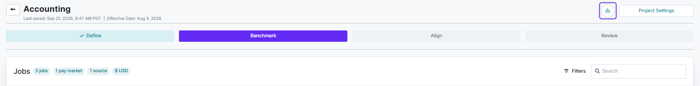

<Note>
Exporting is available within the **Benchmark**, **Align**, and **Review** pages.
</Note>

## Addressing Warnings

Warnings come in two types: critical and caution. Critical warnings must be addressed for you to proceed. Caution warnings aren't required to be addressed, but you may want to be aware of any issues.

To address warnings:

1. Click the relevant warning type, as needed. The **Jobs** table will filter to display only your selected warning type.

   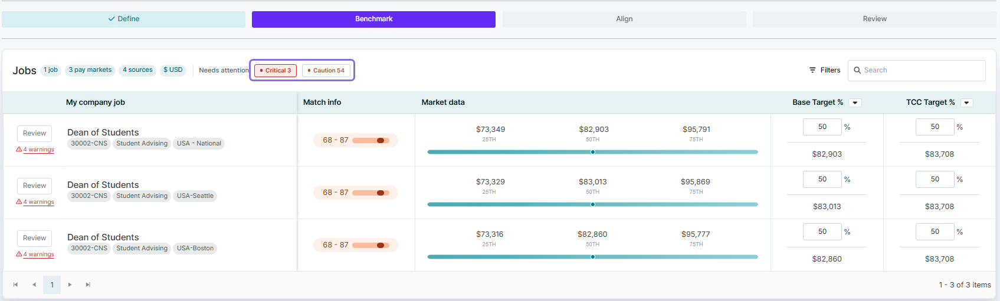

2. Navigate to a relevant job's row and within the *My company job* column, click the relevant warning label. A **This job's warnings** list will appear. For more information on job warnings, see [Smart Price: Understanding Job Warnings](/payfactors/reference/smart-price-understanding-job-warnings).

   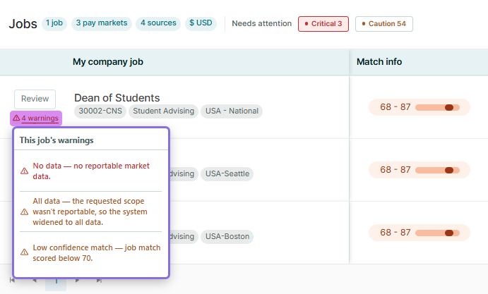

   <Note>
   The number of warnings listed on the label is a count of all warnings within the included data cuts and job matches.
   </Note>

3. To see a breakdown of warnings, click the relevant job's row and click the warning label.

   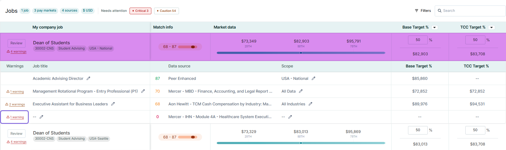

## Reviewing and Editing AI-Matched Market Jobs

To review and edit an AI-matched market job:

1. Search and/or filter the table information, as needed. For more information, see Smart Price: Searching and Filtering in Smart Price.

   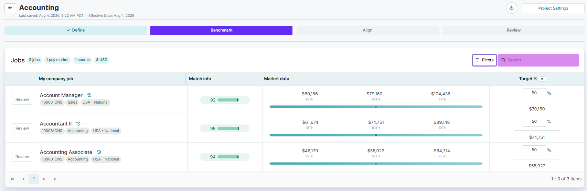

2. To view a job's pricing history:
   1. Click the **History** icon, , associated with the relevant job.

      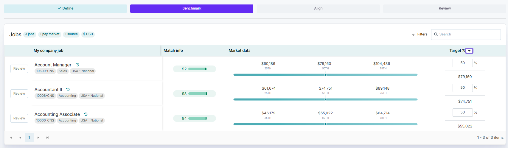

   2. Within the **Previously Priced** window, view details like the job's effective date, data source, job matches, and sources. For additional information, expand the relevant job match.

      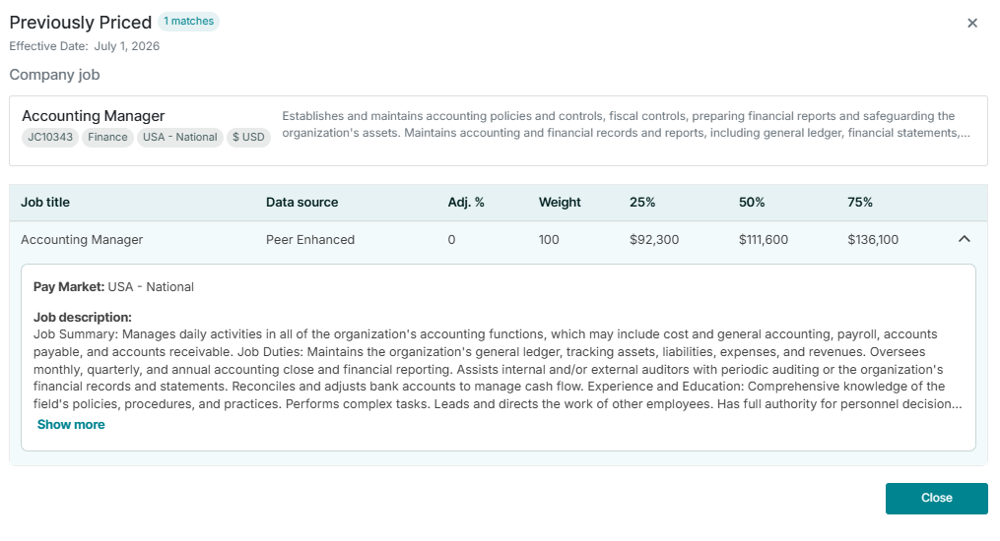

3. Set the target percentile in one of the following ways:
   1. To apply the target percentile to all jobs:
      1. Expand the *Target %* dropdown.

         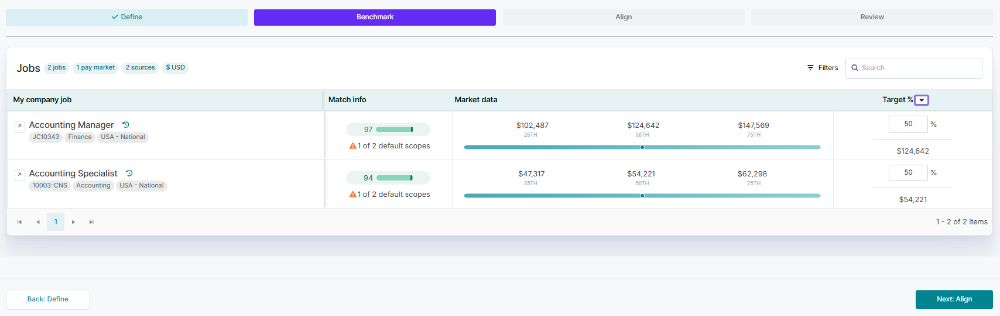

      2. Adjust the *%* field, as needed, and click **Apply**.

         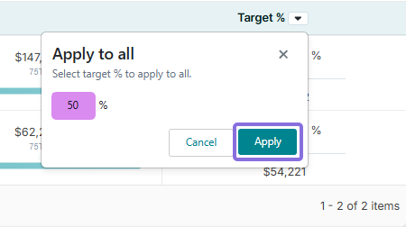

   2. Alternatively, to apply a target percentile to individual jobs, enter a percentile into the associated *%* field. The data will automatically update.

      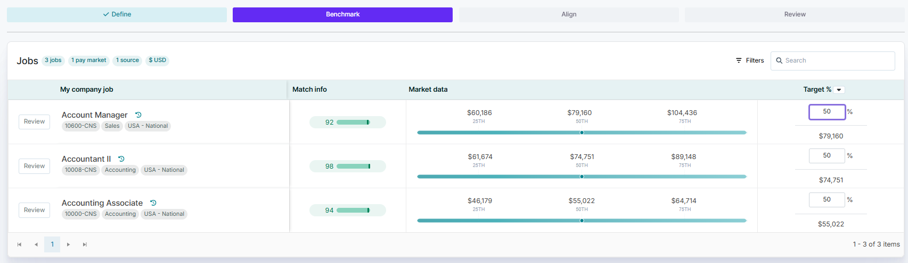

4. To **Review** a company job's details, click the associated **Review** button. You'll be taken to  the **Composite Detail** page. For more information, see Smart Price: Editing a Company Job Match.

   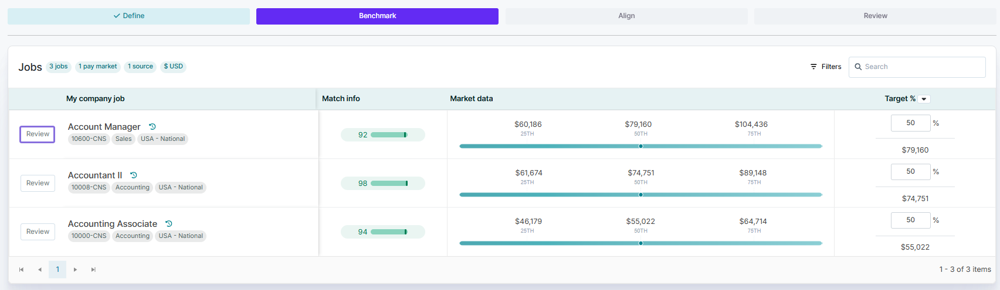

5. To edit a  company job match:
   1. Expand the relevant company job row.

      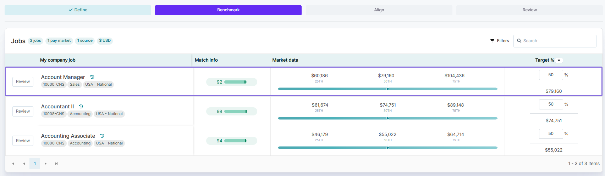

   2. From the list of source jobs, click the **Edit** icon, , associated with the relevant job. You'll be taken to the **Composite Detail** page's relevant **Adjust Scope** panel. For more information, see Smart Price: Editing a Company Job Match.

      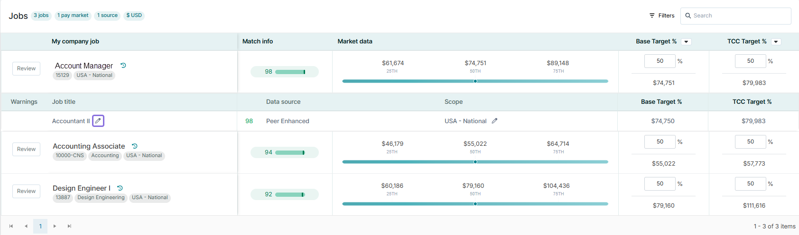

6. Click **Next: Align**. You'll be taken to the **Align** workflow. For more information, see Smart Price: Aligning Employee Data with Benchmarked Jobs.

   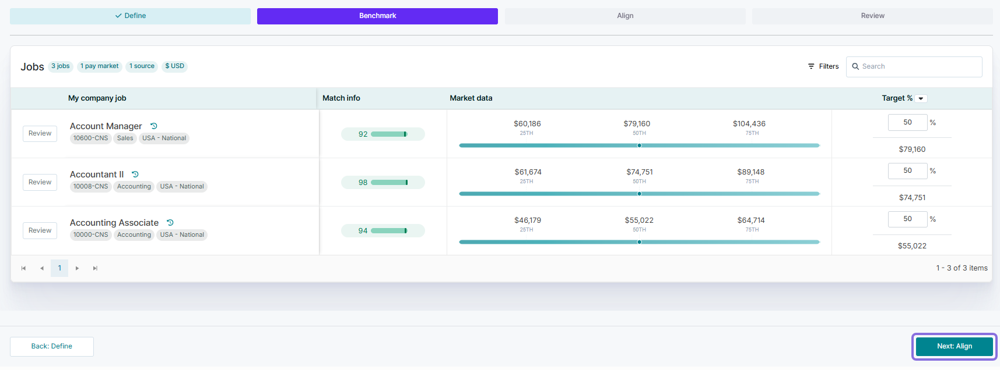
