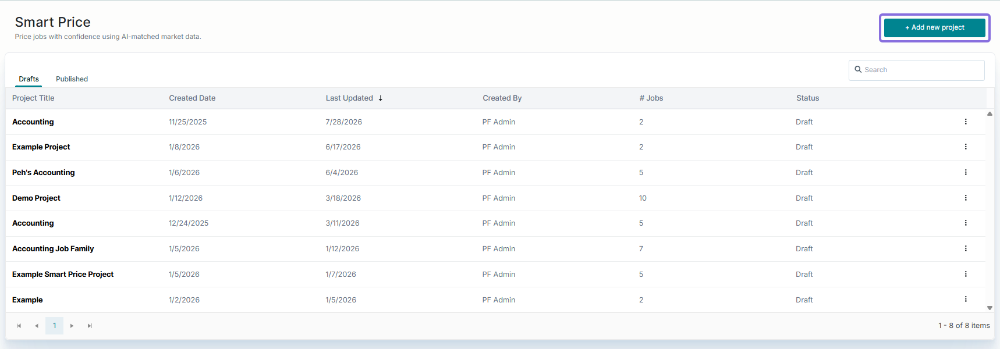
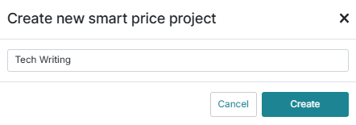
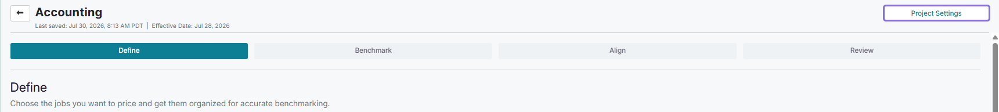
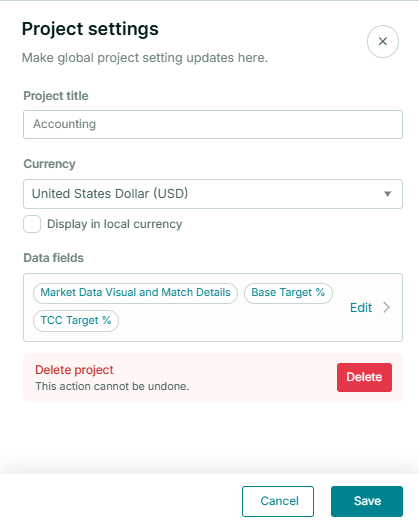
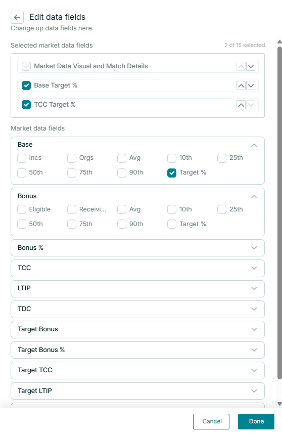
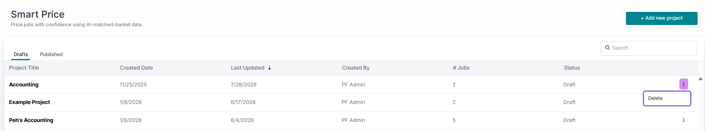
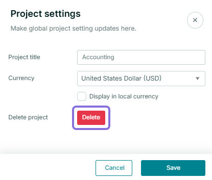
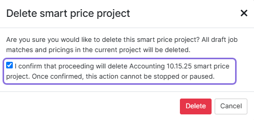
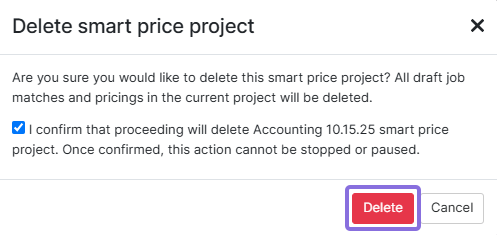

<a href="/payfactors">Payfactors</a>›<a href="/payfactors/how-to">How-To Guides</a>

Within **Smart price**, you can match, benchmark, and align your job pricings with precision. This step-by-step process combines AI-powered job matching, visual metrics, and flexible pay-targeting tools to help you benchmark and price jobs. This article details how to create, edit, and delete a benchmarking project. For additional information on using **Smart price**, see the following associated articles:

To access from your homepage, navigate to **Workflows** > **Smart price** or **Execute** > **Pricing** > **Smart price**, depending on your view.

## Creating a Smart Price Project

To create a  project:

1. Click **Start smart price project**.

   

2. From the **Create new smart price project** window:

   

   1. Enter a *Project Title*.
   2. Click **Create**. You'll be taken to the **Define** workflow. For more information, see Smart Price: Defining Smart Price Projects.

## Managing Your Project Settings

Within **Project Settings**, you can edit your project name, adjust your currency, edit your data fields, and delete your project.

To manage your **Project Settings**:

1. From a project, click **Project Settings**. The **Project settings** panel will open.

   

2. From the **Project settings** panel:

   

   1. Enter the *Project title*.
   2. Search for and/or select the *Currency* or check the *Display in local currency* box.

      <Note>
      Using the *Display in local currency* checkbox disables the *Currency* dropdown. The checkbox will use the currency selected for the pay market(s) within the project.
      </Note>

   3. To edit your **Data fields**, click **Edit** and from the **Edit data fields** panel, do the following:

      

      1. Remove data fields from the **Selected market data fields** section by unchecking the associated box(es).
      2. To reorder your visible market data fields, click the relevant navigational chevron. This ordering is visible in the **Align** workflow.
      3. To add additional data fields, expand the relevant section and check the necessary box(es).
      4. Click **Done**.
   4. Click **Save**.

## Deleting a Smart Price Project

<Note>
Once your project has been published, it can't be deleted.
</Note>

To delete your **Smart price** project:

1. Delete your **Smart price** project in one of the following ways:
   1. From the **Smart price** landing page, locate the relevant project, click the associated **Actions** icon, , and click **Delete**.

      

   2. Alternatively, from within a project, click **Project Settings**.

      

2. From the **Project settings** panel:
   1. Click **Delete**.

      

   2. Review the information and enable the confirmation checkbox.

      

   3. Click **Delete**.

      
