
<a href="/payfactors">Payfactors</a>›<a href="/payfactors/how-to">How-To Guides</a>

Within **Smart reporting**, you can apply filters to reports with visible filters and parameters (also called query tokens). For a brief description on query tokens, see Smart Reporting: Interacting with Generated Tables and Charts.

To apply report filters:

1. Within a relevant **Smart reporting** report, click a filter/parameter.

   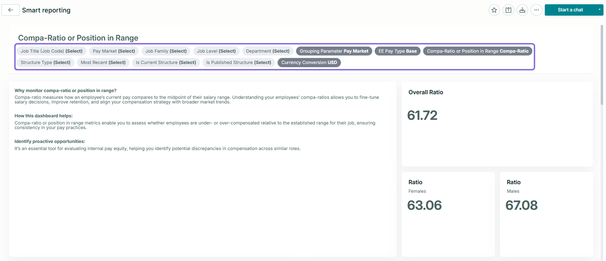

2. From the **Apply filters and parameters** window, on the left-hand side, navigate to the relevant filter/parameter.

   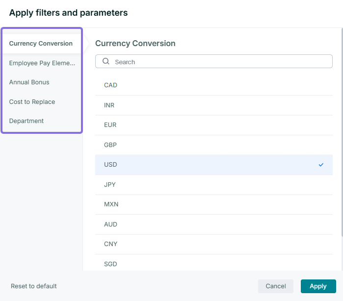

## Applying Include/Exclude Filters

To apply include/exclude filters:

1. Within the **Apply filters and parameters** window, from the relevant filter section, navigate to the **Include** or **Exclude** tab, as needed.

   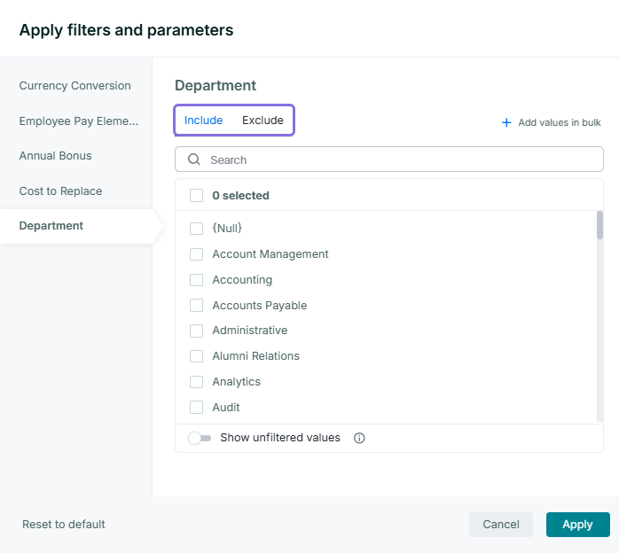

2. To find the available values, search and/or select the relevant data.

   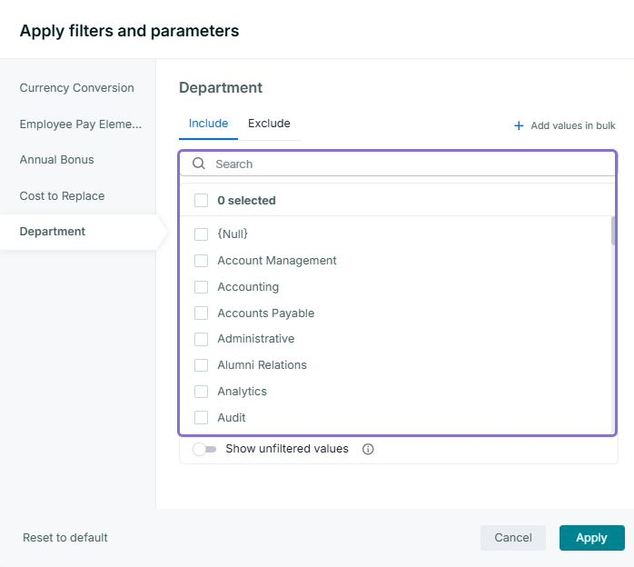

3. Enable/disable *Show unfiltered values*, as needed.

   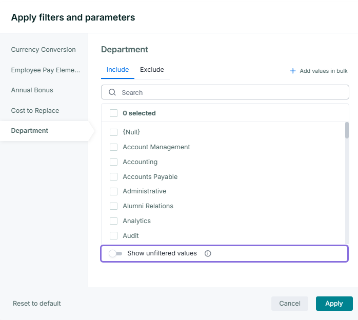

Example: If you select "10" within your **Job Level** filter, you'll only see job families with a "10" job level in the **Job Family** filter. Enabling the toggle would display a list of all job families.

4. To add values in bulk:
   1. Click **+ Add values in bulk**.

      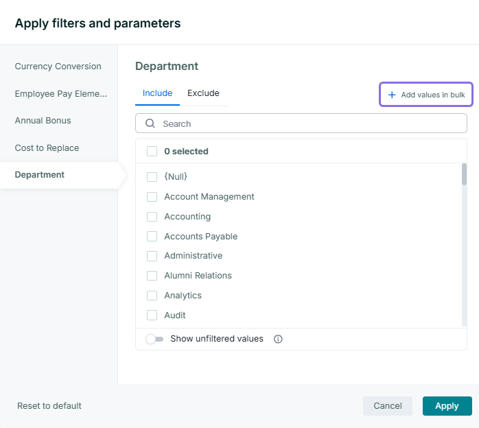

   2. Enter relevant values and click **Add values**. Separate values by using a comma or semicolon or putting each value on a separate line.

      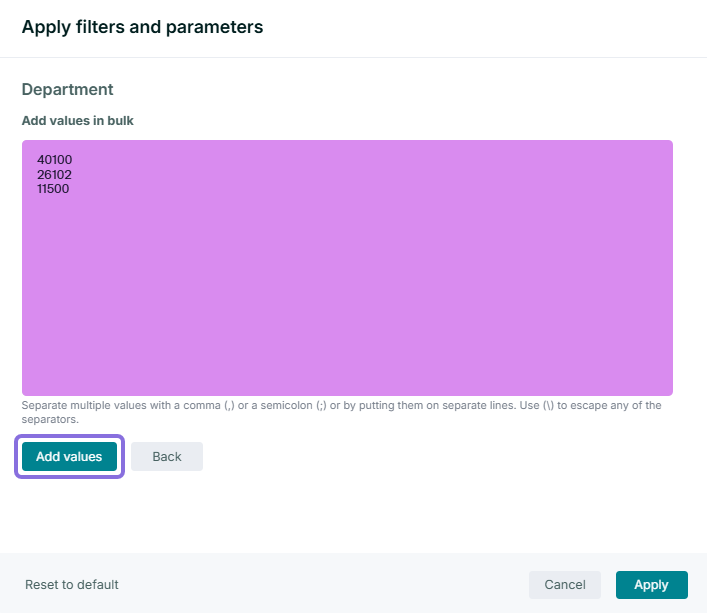

5. Click **Apply**.

   

## Applying Single-Value Filters

Apply single-value filters in one of the following ways:

1. Within the **Apply filters and parameters** window, from the relevant single-value filter section, do the following:
   1. When you have predefined options, search for and/or select the relevant value.

      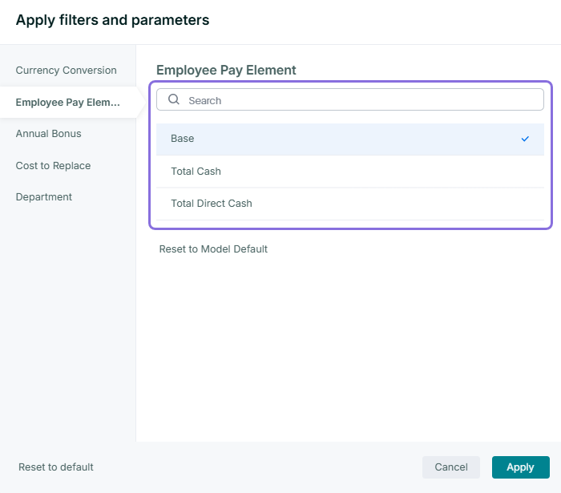

   2. Alternatively, when you can enter a value, edit the necessary value, as needed.

      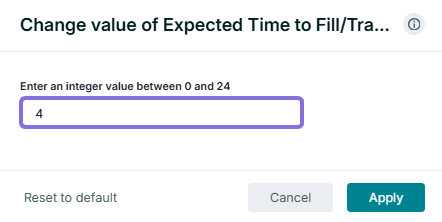

2. To reset the filter to its original settings, click **Reset to default**, as needed.

   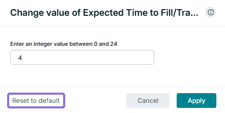

3. Click **Apply**.

   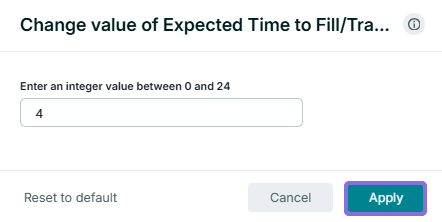

## Applying Condition Filters

To apply condition filters:

1. From the associated filter's window, adjust the *Condition* and *Value*, as needed.

   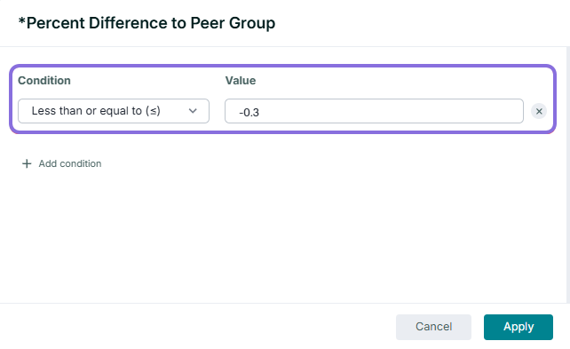

   <Note>
   Based on the type of *Condition*, the *Value* field(s) may vary.
   </Note>

2. To add another condition, click **+ Add condition** and repeat the [previous steps](#From), as needed.

   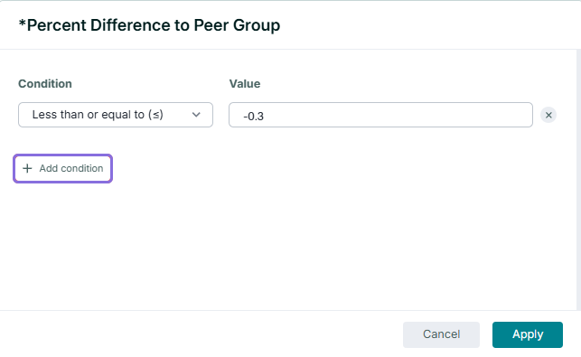

3. Click **Apply**.

   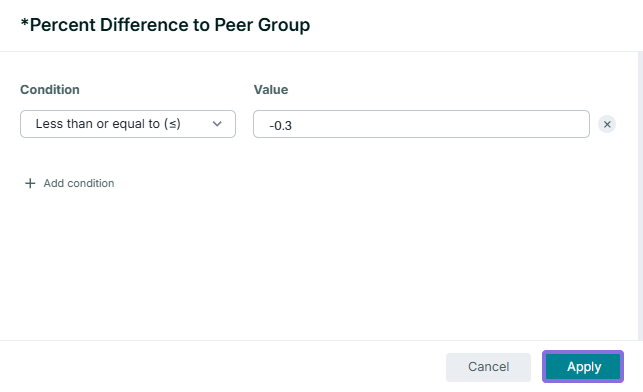
