
<a href="/payfactors">Payfactors</a>›<a href="/payfactors/how-to">How-To Guides</a>

With the **Smart reporting** agent, users can type questions like 'Show me pay equity by department?' or 'How does our compa-ratio vary by job level?' and receive visualizations based on their company's data and permissions. Below your visualization, you'll see a summary of what data the visualization is built from.

For information on your report catalog, see Smart Reporting: Navigating the Report Catalog.

To use the reporting agent:

1. From the **Smart reporting** landing page:
   1. If you know the model best suited to your question, you can choose the dataset that aligns with your question by clicking **Asking About**.

      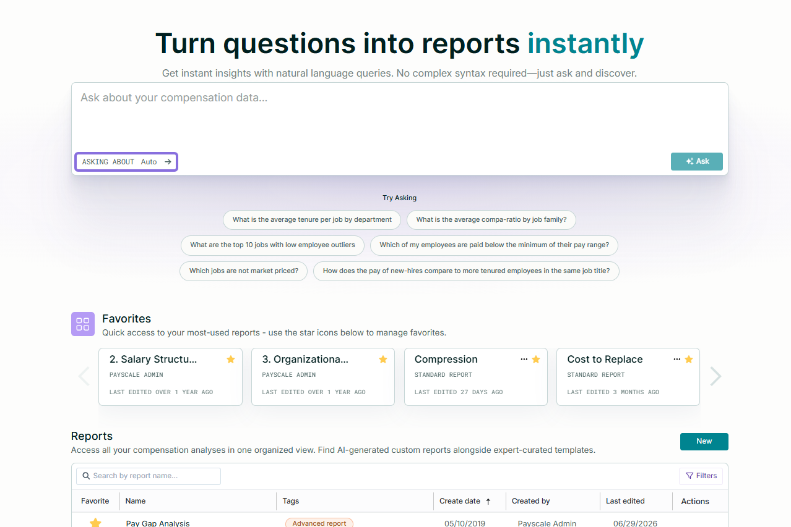

      <Note>
      Leaving the model on "Auto" should select the correct model for most queries.
      </Note>

   2. From the **What are you asking about?** window, select your dataset  and click **Save**.

      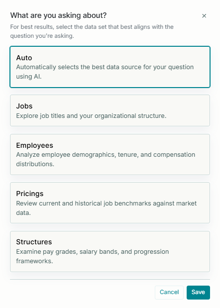

2. Enter a question or choose from any of the **Try Asking** suggestions.

   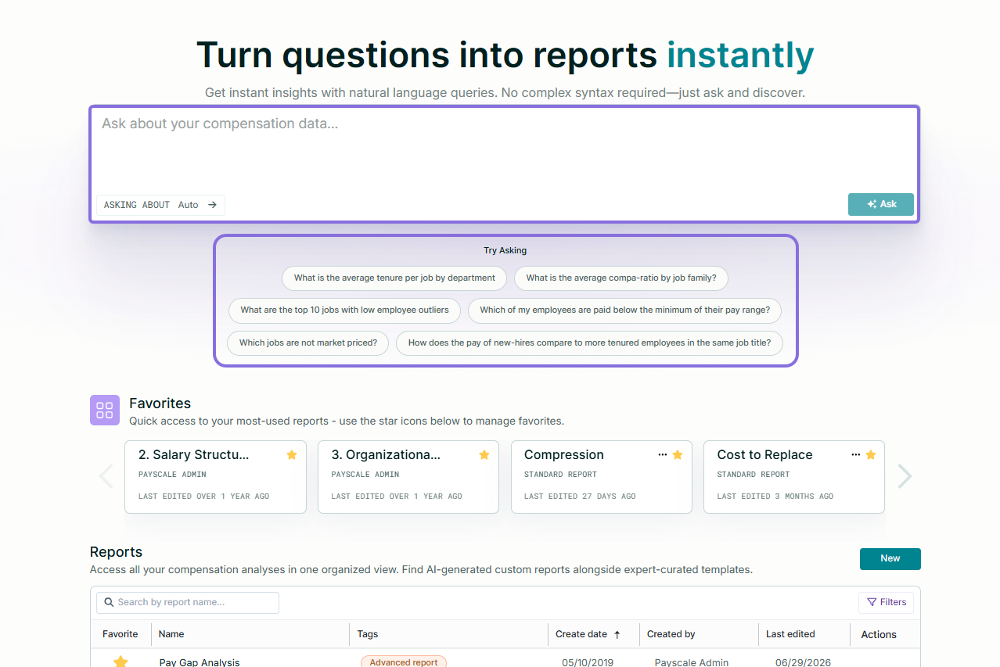

3. Click **Ask**. Your report will be generated. For information on managing tables or charts, see Smart Reporting: Interacting with Generated Tables and Charts.

   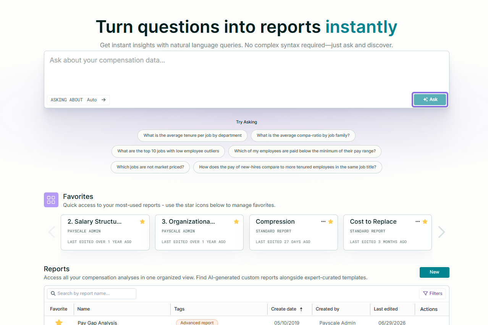

<Note>
In some instances, the platform may not have enough data and an alert will appear in place of a report.
</Note>

## Starting a New Chat and Managing Your Chat History

Your chat history will display all previous activity, listing the last seven days first.

To start a new chat and/or manage your chat history:

1. Click the **Panel** icon, .

   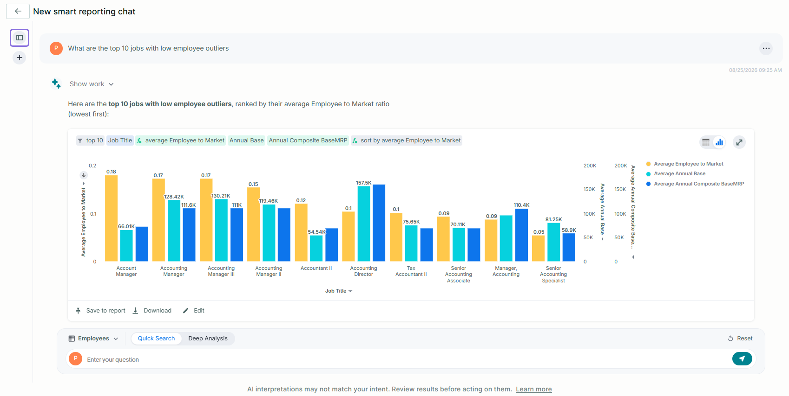

2. From the **Chat history** panel:
   1. To start a new chat, click **New chat** and enter your new question into the relevant field.

      

      <Note>
      When you click **New chat**, your current generated output will be removed, but will still be available in your chat history.
      </Note>

   2. Return to a previous conversation by clicking the relevant chat.

      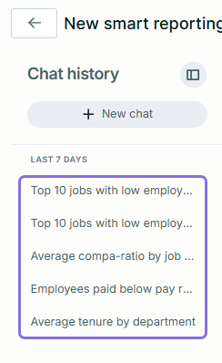

   3. To rename a chat:
      1. Click the associated **Actions** icon, , and click **Rename**.

         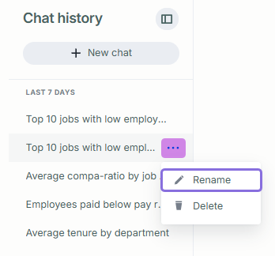

      2. Enter the new name and press Enter on your keyboard.

         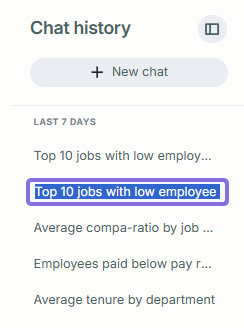

   4. To delete a chat:
      1. Click the associated **Actions** icon, , and click **Delete**.

         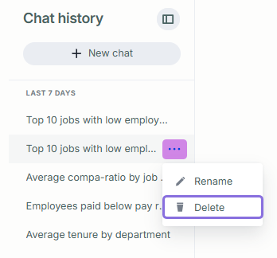

      2. From the **Delete chat** window, click **Delete**.

## Editing Your Question

To edit your question:

1. From the **Smart reporting** chat, edit your question by doing the following:
   1. Click the **Actions** icon, , and click **Edit**.

      

      <Note>
      Editing your question or changing the model will rebuild the entire response. If you need to add or modify the chart, ask a follow-up question. To ask a follow-up question, see [Refining Your Question](#Refining).
      </Note>

   2. Adjust the text and click **Done**.

      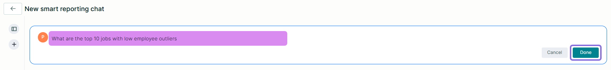

2. To delete your question, click the **Actions** icon, , and click **Delete**.

   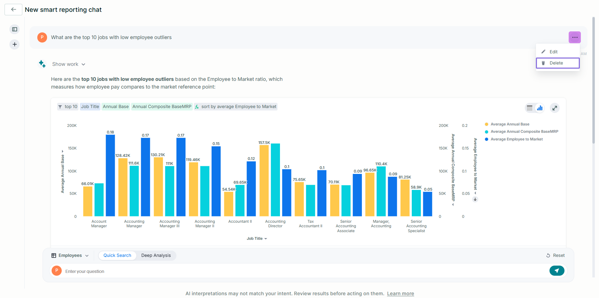

3. If your model is incorrect for the question or you want to enter a new question with a different model, adjust your data model by doing the following:
   1. Click the selected data model.

      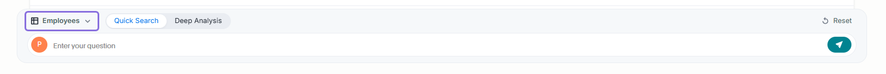

   2. From the **Select data model** window:

      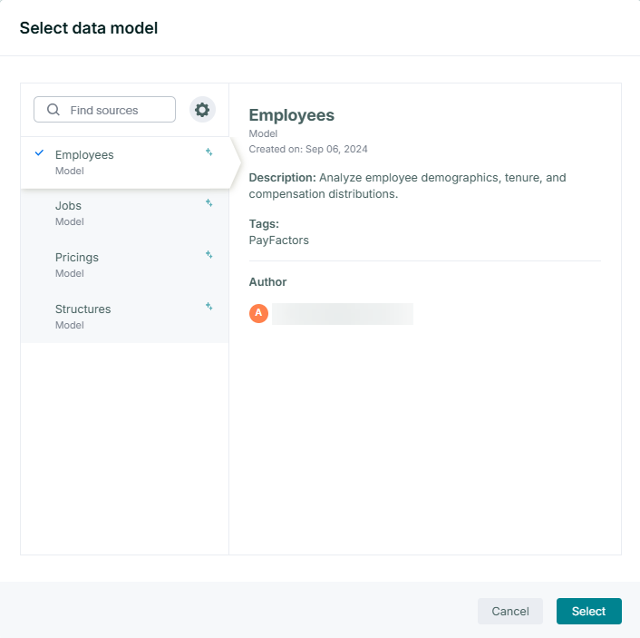

      3. Search from the *Find sources* field by entering the relevant keyword(s).
      4. Filter your search by clicking the **Filter** icon, and selecting the relevant filter(s).
      5. Select the relevant data model.
      6. Click **Select**.

### Refining Your Question

Refine your original query by asking follow-up questions. The conversation is context-aware, meaning each new question builds on the previous response(s).

To refine your question:

1. Choose **Quick Search** or **Deep Analysis**, as needed. While **Quick Search** will provide relevant charts and answers from your data within the system, **Deep Analysis** offers in-depth, multistep insights that assess and explain data patterns.

   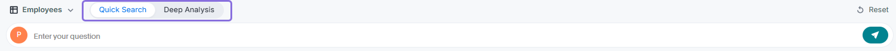

   <Note>
   Queries best handled by **Deep Analysis** are "why" questions. For example "Why is compa-ratio lower in Engineering than other departments" or "Why are certain job families showing wider pay range penetration variance?"
   </Note>

2. Within the prompt field at the bottom of the page, enter your question and click the **Enter** icon.

   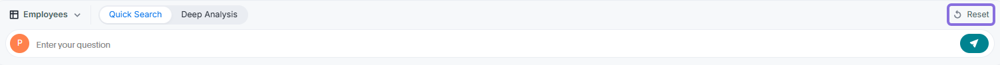

3. To reset your progress and begin again, click **Reset**. Your question and previous chart information will be removed.

   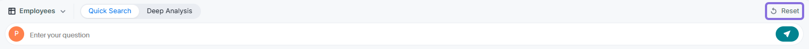
